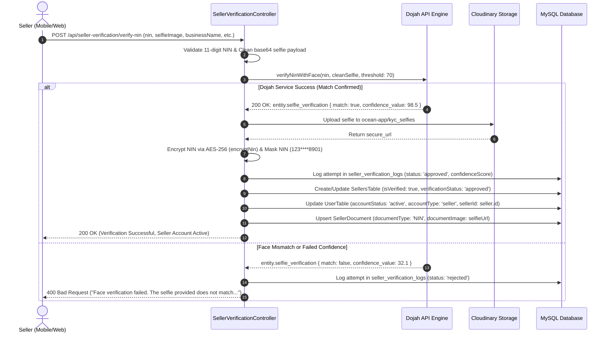

# 🪪 Automated Seller Identity & NIN Verification System

This document details the **Automated Seller Identity Verification Pipeline** in `ocean_server`, featuring **Biometric Facial Recognition** (camera selfie vs. NIMC record photo) powered by Dojah API, AES-256 NIN Encryption, and Verification Leveling.

---

## 📌 Architectural Overview & Design Philosophy

To prevent seller fraud and identity spoofing on the marketplace, seller onboarding incorporates an automated identity verification engine:
1. **Biometric Face Matching**: The seller submits an 11-digit NIN and takes a live camera selfie. Dojah API queries official government NIMC records (`POST /api/v1/kyc/nin/verify`) and biometrically compares the selfie against the NIMC photo.
2. **Confidence Thresholding**: Verification only succeeds if Dojah returns a facial match confidence score $\ge 60\%$. If the selfie does not match the NIMC photo, the endpoint returns an exact 400 error: `"Face verification failed. The selfie provided does not match the photo on your NIMC record."`
3. **AES-256 NIN Encryption**: Raw 11-digit NIN numbers are **NEVER** stored in plain text. They are encrypted using AES-256-CBC algorithm prior to database persistence.
4. **NIN Masking**: Document records display only masked NIN representations (e.g. `123****8901`).
5. **Instant Account Upgrade**: Upon successful biometric verification:
   - `users.accountStatus` transitions to `'active'`.
   - `users.accountType` transitions to `'seller'`.
   - `sellers.isVerified` becomes `true` (`verificationStatus = 'approved'`).
   - A `SellerDocument` record is automatically created/updated with the Cloudinary selfie URL.

---

## 🗄️ Database Schemas & Audit Trail

### 1. `seller_verification_logs` Table
Audit trail logging every Dojah verification attempt.
- `id` (UUID, Primary Key)
- `user_id` (UUID, Foreign Key -> `users.id`)
- `seller_id` (UUID, Foreign Key -> `sellers.id`, Nullable)
- `verification_type` (`VARCHAR`): Set to `'NIN_FACIAL_DOJAH'`.
- `nin_number` (`TEXT`): AES-256 Encrypted NIN string.
- `nimc_first_name` (`VARCHAR`): Official first name retrieved from NIMC.
- `nimc_last_name` (`VARCHAR`): Official last name retrieved from NIMC.
- `nimc_dob` (`VARCHAR`): Official date of birth from NIMC.
- `nimc_phone` (`VARCHAR`): Official phone number from NIMC.
- `nimc_state` (`VARCHAR`): Official state of residence from NIMC.
- `nimc_photo_url` (`TEXT`): Cloudinary URL of selfie photo.
- `dojah_reference_id` (`VARCHAR`): Dojah API tracking reference ID.
- `confidence_score` (`DECIMAL(5,2)`): Facial match percentage score (e.g., `94.80`).
- `status` (`ENUM`: `'approved'`, `'rejected'`, `'failed'`).
- `failure_reason` (`TEXT`, Nullable).
- `raw_response` (`JSON`): Complete raw NIMC response data.

### 2. `seller_documents` Table
Document verification state displayed in admin panel and seller profile.
- `id` (UUID, Primary Key)
- `seller_id` (UUID, Foreign Key -> `sellers.id`)
- `document_type` (`ENUM`: `'NIN'`, `'DriversLicense'`, `'Passport'`, `'BusinessCertificate'`, `'BusinessLicense'`).
- `document_number` (`VARCHAR`): Masked NIN representation (e.g. `123****8901`).
- `document_image` (`TEXT`): Cloudinary URL of selfie/document image.
- `status` (`ENUM`: `'pending'`, `'approved'`, `'rejected'`).
- `verified_at` (`DATETIME`).
- `verification_notes` (`TEXT`).

---

## ⚙️ Biometric Verification Flow Diagram



---

## 🔑 Dojah API Integration & Response Structure

### 1. Request Schema
- **Endpoint**: `POST https://api.dojah.io/api/v1/kyc/nin/verify`
- **Headers**:
  - `AppId`: Your Dojah application App ID
  - `Authorization`: Raw Secret Key (no `Bearer` prefix)
  - `Content-Type`: `application/json`
- **Body**:
  ```json
  {
    "nin": "20652577715",
    "selfie_image": "<clean_base64_string>",
    "threshold": 70
  }
  ```

### 2. Response Schema & Nested Object Extraction
Dojah returns NIMC identity records alongside a **nested `selfie_verification` object**:

```json
{
  "entity": {
    "nin": "20652577715",
    "firstname": "RINFWANG",
    "surname": "DASPAN",
    "gender": "m",
    "birthdate": "1995-08-20",
    "telephoneno": "08012345678",
    "residence_state": "Plateau",
    "selfie_verification": {
      "confidence_value": 98.51,
      "match": true
    }
  }
}
```

> [!IMPORTANT]
> **Nested Extraction Requirement**:
> Facial verification results (`match` and `confidence_value`) are contained inside `entity.selfie_verification`. The backend checks `entity.selfie_verification.match` and `entity.selfie_verification.confidence_value` with resilient fallbacks to ensure compatibility.

### 3. Field Mapping Reference

| NIMC Profile Data | Dojah Primary Field | Fallback Aliases Supported |
| :--- | :--- | :--- |
| **First Name** | `firstname` | `first_name` |
| **Last Name / Surname** | `surname` | `last_name` |
| **Date of Birth** | `birthdate` | `dob` |
| **Phone Number** | `telephoneno` | `mobile`, `phone_number` |
| **State of Residence** | `residence_state` | `state` |
| **Face Match Boolean** | `selfie_verification.match` | `match` |
| **Match Confidence Score** | `selfie_verification.confidence_value` | `confidence_value` |

---

## ⚙️ Environment Variables Reference

| Variable Name | Default Value | Description |
| :--- | :--- | :--- |
| `DOJAH_BASE_URL` | `https://api.dojah.io` | Base URL for Dojah production API |
| `DOJAH_APP_ID` | *Required* | Dojah Application ID from dashboard |
| `DOJAH_SECRET_KEY` | *Required* | Dojah API Secret Key |
| `DOJAH_MATCH_THRESHOLD` | `70` | Biometric match tolerance threshold (50–100). Defaults to 70 for optimal real-world selfie recognition |

---

## 🔌 API Endpoints Reference

### Verification API Routes

| HTTP Method | Endpoint Path | Payload / Query | Description |
| :--- | :--- | :--- | :--- |
| `POST` | `/api/seller-verification/verify-nin` | `{ nin, selfieImage, businessName, businessAddress, state }` | Primary automated NIN & facial recognition verification |
| `POST` | `/api/seller-verification/nin` | `{ nin, selfieImage, businessName, businessAddress, state }` | Alias endpoint for backward compatibility |
| `POST` | `/api/seller-verification/submit` | Multipart: `businessDocument`, `personalId`, text fields | Manual document submission for admin review |
| `GET` | `/api/seller-verification/status` | Header: `Authorization: Bearer <token>` | Fetch seller's current verification status & score |
| `GET` | `/api/seller-verification/requirements` | Public | Fetch verification levels requirements list |

### Admin Moderation Routes (Admin Auth Required)

| HTTP Method | Endpoint Path | Payload | Description |
| :--- | :--- | :--- | :--- |
| `POST` | `/api/seller-verification/admin/review` | `{ sellerId, status, rejectionReason }` | Admin manual approval or rejection of seller application |
| `GET` | `/api/seller-verification/admin/stats` | Header: `Authorization: Bearer <token>` | Fetch platform-wide verification stats breakdown |

---

## 🛠️ Audit Summary & Improvements Made

During the system audit of Seller Verification:
1. **Fixed Dojah Facial Response Parser**: Resolved an issue where facial match was read from `entity.match` instead of Dojah's nested `entity.selfie_verification.match`, which previously caused successful Dojah lookups to report false facial mismatches.
2. **Threshold Calibration**: Added `DOJAH_MATCH_THRESHOLD=70` (down from Dojah's strict default of 90) to ensure high-accuracy selfie matches are not falsely rejected due to minor room lighting or camera differences.
3. **NIMC Field Extraction**: Unified name, date of birth, and telephone extraction across both standard Dojah fields (`firstname`, `surname`, `birthdate`, `telephoneno`) and legacy aliases (`first_name`, `last_name`, `dob`, `mobile`).
4. **Base64 Sanitization**: Enhanced Data URL prefix stripping to handle all standard image mime types (`image/jpeg`, `image/png`, `image/webp`).
5. **Fixed `accountType` Update Bug**: Corrected `user.update({ accountStatus: 'active', role: 'seller' })` to `user.update({ accountStatus: 'active', accountType: 'seller', sellerId: seller.id })`.
6. **AES-256 Storage Security**: Confirmed that `encryptNin` and `decryptNin` use AES-256-CBC encryption to guarantee raw government NIN numbers are protected at rest.

