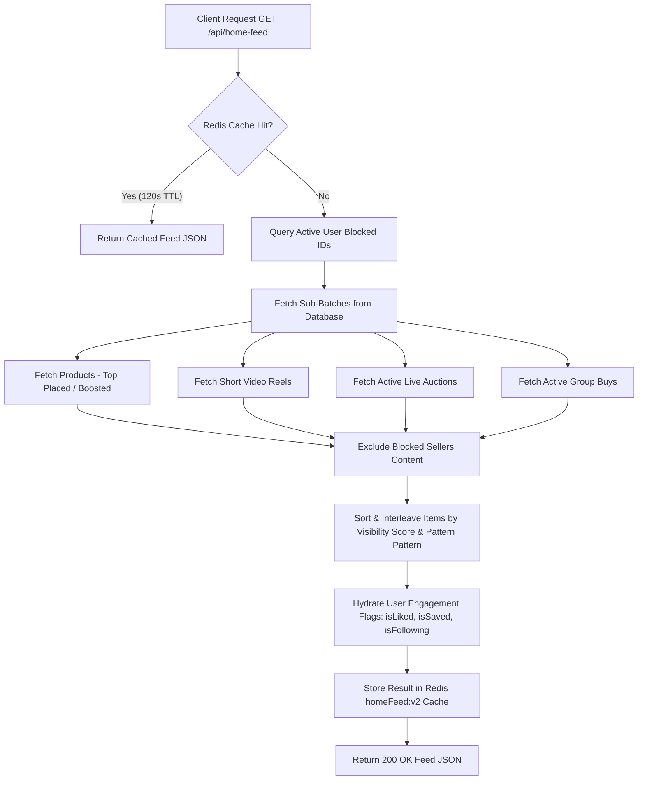

# 🌊 Unified Discovery Feed & Recommendation Engine

This document details the **Unified Discovery Feed Architecture** in `ocean_server`, covering multi-entity feed interleaving (Products, Short Videos, Auctions, Group Buys), visibility score ranking, Redis feed caching, and user block exclusions.

---

## 📌 Architectural Overview & Interleaving Philosophy

The Discovery Feed implements a modern, TikTok/Amazon-style **interleaved multi-entity stream**. Rather than displaying plain product grids, the feed blends 4 distinct deal formats into a unified engagement timeline:

```
[ Product ] ──> [ Product ] ──> [ Short Video Reel ] ──> [ Live Auction ] ──> [ Group Buy ] ──> [ Product ]
```

### Key Architectural Pillars:
1. **Dynamic Multi-Factor Ranking**: Feed items are sorted dynamically by `visibility_score`, calculated from engagement metrics (views, likes, saves), seller subscription tier (`Surge`, `Tide`), and recency decay.
2. **High-Performance Redis Caching**: Feed responses are cached in Redis under `homeFeed:v2:<page>:<limit>:<country>:<userId>` with a **120-second (2 minute) TTL**.
3. **Block Exclusion Filter**: Automatically filters out content created by sellers blocked by the current authenticated user (`userBlockHelper.getBlockedUserIds`).
4. **Standardized Feed Item Payload**: Normalizes products, videos, auctions, and group buys into a unified JSON structure so mobile/web apps render a single timeline component seamlessly.

---

## ⚙️ Standardized Feed Item Response Payload

Every item in the discovery feed response is normalized to this standard schema:

```json
{
  "id": "item-uuid-123",
  "itemType": "product", // "product", "video", "auction", "group_buy"
  "title": "iPhone 15 Pro Max 256GB",
  "description": "Brand new sealed in box",
  "price": 1200.00,
  "originalPrice": 1400.00,
  "currency": "USD",
  "category": "Electronics",
  "subcategory": "Smartphones",
  "condition": "new",
  "location": "Lagos, Nigeria",
  "media": [
    {
      "id": "media_0",
      "type": "image",
      "url": "https://res.cloudinary.com/ocean/image/upload/v123/phone.jpg",
      "thumbnailUrl": "https://res.cloudinary.com/ocean/image/upload/v123/phone_thumb.jpg",
      "order": 0
    }
  ],
  "user": {
    "id": "seller-user-uuid",
    "name": "Tech Galaxy Store",
    "businessName": "Tech Galaxy Store",
    "avatar": "https://res.cloudinary.com/ocean/image/upload/v123/avatar.jpg",
    "verified": true,
    "role": "seller",
    "location": "Lagos, Nigeria"
  },
  "engagement": {
    "viewsCount": 1420,
    "likesCount": 85,
    "savedCount": 42,
    "isLiked": false,
    "isSaved": false,
    "isFollowing": true
  },
  "boostStatus": {
    "isBoosted": true,
    "isTopPlaced": false,
    "isSpotlighted": true
  },
  "createdAt": "2026-09-27T12:00:00.000Z"
}
```

---

## 🗄️ Interleaving Engine Logic (`feedcontroller.getHomeFeed`)



---

## 🔌 Feed API Endpoints Reference

| Endpoint Path | Method | Auth / Query Params | Description |
| :--- | :--- | :--- | :--- |
| `/api/home-feed` | `GET` | Optional Auth, `page`, `limit`, `country` | Primary interleaved discovery feed (Redis cached 120s) |
| `/api/feed` | `GET` | Public, `page`, `limit` | Legacy post feed |
| `/api/search` | `GET` | Public, `query`, `category`, `type` | Multi-entity global search endpoint |
| `/api/posts` | `POST` | Auth Required, Multipart media | Create a new user post / feed item |
| `/api/posts/:postId` | `GET` | Public | Single post details with comments |
| `/api/posts/:postId/like` | `POST` | Auth Required | Toggle like status on post |
| `/api/posts/:postId/comments` | `POST` | Auth Required, `{ content }` | Post a comment on a feed item |
| `/api/posts/:postId/comments` | `GET` | Public | Fetch comments list for a post |

---

## 🛠️ Audit Summary & Architecture Confirmation

1. **Modern Interleaving Verified**: Confirmed that the discovery feed implements application-level multi-entity interleaving with Redis caching.
2. **Zero DB Locks**: Feed ranking executes in Node.js application memory with indexed queries, ensuring fast response times without locking MySQL database tables.
