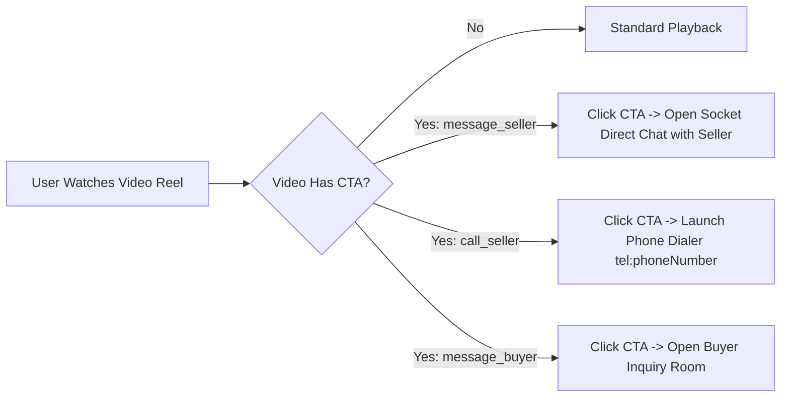

# 🎥 Video Feed & Reels System Architecture

This document provides a comprehensive technical reference for the **Video Feed Engine, Short Product Reels, Call-To-Action Buttons, and Engagement Analytics** in `ocean_server`.

---

## 📌 Architectural Overview & Philosophy

The Video Feed & Reels System delivers an immersive, short-form video engagement experience similar to TikTok and Instagram Reels, tailored specifically for e-commerce discovery:
1. **100MB Video Uploads**: Sellers and buyers upload MP4/MOV videos up to 100MB via `POST /api/videos`. Assets are processed and stored on Cloudinary.
2. **Call-To-Action (CTA) Direct Actions**: Videos feature integrated action buttons (`ctaType`: `'message_seller'`, `'call_seller'`, `'message_buyer'`, `'none'`) allowing buyers to open a direct chat or call the seller straight from the video reel.
3. **Role Differentiation**:
   - `videoRole: 'seller'`: Promotional product showcase video uploaded by a seller.
   - `videoRole: 'buyer'`: Video request or product inquiry uploaded by a buyer.
4. **Deduplicated Analytics**: Video views (`views_count`), likes (`like_count`), comments (`comment_count`), and shares (`share_count`) track real-time engagement.

---

## 🗄️ Database Schema (`videos` Table)

- `id` (`UUID`, Primary Key, `UUIDV4`)
- `user_id` (`UUID`, Foreign Key -> `users.id`)
- `video_url` (`VARCHAR(500)`, `NOT NULL`): Cloudinary video stream URL.
- `thumbnail_url` (`VARCHAR(500)`, `NULLABLE`): Video poster image URL.
- `description` (`TEXT`, `NULLABLE`): Caption / text description.
- `cta_enabled` (`BOOLEAN`, Default `true`)
- `cta_type` (`ENUM`: `'message_seller'`, `'call_seller'`, `'message_buyer'`, `'none'`, Default `'none'`)
- `cta_label` (`VARCHAR(100)`, `NULLABLE`): Custom button label (e.g. *"Message Seller for Wholesale Price"*).
- `video_role` (`ENUM`: `'seller'`, `'buyer'`, Default `'seller'`)
- `duration` (`INTEGER`, `NULLABLE`): Video duration in seconds.
- `file_size` (`BIGINT`, `NULLABLE`): File size in bytes.
- `mime_type` (`VARCHAR(100)`, `NULLABLE`)
- `like_count` (`INTEGER`, Default `0`)
- `comment_count` (`INTEGER`, Default `0`)
- `share_count` (`INTEGER`, Default `0`)
- `views_count` (`INTEGER`, Default `0`)
- `is_sponsored` (`BOOLEAN`, Default `false`)
- `status` (`ENUM`: `'active'`, `'inactive'`, `'deleted'`, Default `'active'`)
- `created_at` (`DATETIME`)
- `updated_at` (`DATETIME`)

---

## ⚙️ Call-To-Action (CTA) Flow Diagram

---

## 🔌 API Endpoints Reference

### Public Routes

| Endpoint Path | Method | Description |
| :--- | :--- | :--- |
| `/api/videos` | `GET` | Fetch video reels feed (Optional Auth for engagement flags) |
| `/api/videos/user/:userId` | `GET` | Fetch public videos uploaded by a specific user |
| `/api/videos/:id` | `GET` | Single video details with engagement stats |
| `/api/videos/:id/comments` | `GET` | List comments for a video reel |

### Authenticated Routes

| Endpoint Path | Method | Description |
| :--- | :--- | :--- |
| `/api/videos` | `POST` | Upload a new short video reel (Multipart: `video` file up to 100MB) |
| `/api/videos/:id/like` | `POST` | Toggle like status on video reel |
| `/api/videos/:id/view` | `POST` | Increment video view count |
| `/api/videos/:id/comments` | `POST` | Add a comment to a video reel |
| `/api/videos/comments/:commentId/like` | `POST` | Like a video comment |
| `/api/videos/:id` | `PUT` | Update video title, description, or CTA button |
| `/api/videos/:id` | `DELETE` | Soft-delete video reel |

---

## 🛠️ Audit Summary & Status

1. **CTA Integration Verified**: Confirmed CTA actions route seamlessly to messaging and phone call handlers.
2. **Cloudinary Processing**: Video uploads compress and generate auto-thumbnails on Cloudinary.
