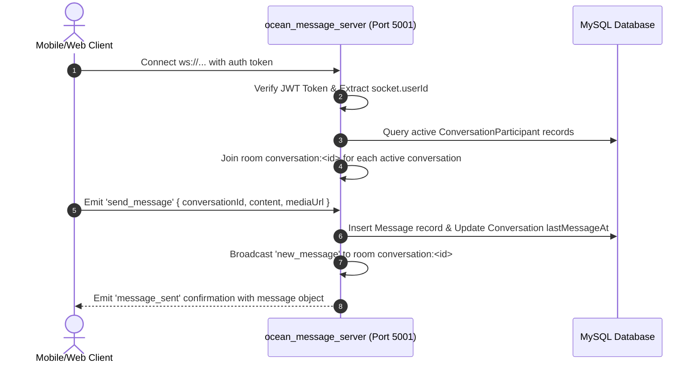

# 💬 Real-Time Chatting & Messaging Engine Architecture

This document details the **Standalone `ocean_message_server` Microservice, Socket.io Real-Time Protocol, Conversation Threads, and Message Delivery Receipts** in `ocean_app`.

---

## 📌 Architectural Overview & Philosophy

Real-time messaging is handled by a dedicated microservice: `ocean_message_server` running on Port 5001:
1. **Standalone Microservice Architecture**: Decoupled from `ocean_server` to ensure chat websockets do not compete for event-loop CPU with API endpoints.
2. **Socket.io Handshake & JWT Verification**: Clients connect via Socket.io (`ws://...`). The socket connection validates the user's JWT token, authenticates `socket.userId`, and auto-joins all active conversation rooms (`conversation:<id>`).
3. **Real-Time Events**:
   - `send_message`: Dispatches instant text or media messages to conversation rooms.
   - `typing_start` / `typing_stop`: Broadcasts real-time typing indicators.
   - `message_read`: Emits read receipts and updates `lastReadAt`.
4. **Rich Content & Context Linkage**: Supports text, image/video URLs, voice notes, nested reply threads (`replyToId`), and entity links (`relatedType`: `'product'`, `'buyer_need'`, `'auction'`, `'swap_deal'`, `'group_buy'`).

---

## 🗄️ Database Schemas (`conversations`, `messages`, `conversation_participants`)

### 1. `conversations` Table
- `id` (`UUID`, Primary Key, `UUIDV4`)
- `title` (`VARCHAR(255)`, `NULLABLE`)
- `type` (`ENUM`: `'direct'`, `'group'`, `'buyer_need'`, `'group_buy'`)
- `lastMessageAt` (`DATETIME`, `NULLABLE`)
- `lastMessageId` (`UUID`, `NULLABLE`)
- `relatedType` (`VARCHAR(50)`, `NULLABLE`, Comment: 'product, buyer_need, group_buy')
- `relatedId` (`VARCHAR(255)`, `NULLABLE`, Comment: 'ID of related entity')
- `createdAt` (`DATETIME`)
- `updatedAt` (`DATETIME`)

### 2. `messages` Table
- `id` (`UUID`, Primary Key, `UUIDV4`)
- `conversationId` (`UUID`, Foreign Key -> `conversations.id`)
- `senderId` (`UUID`, Foreign Key -> `users.id`)
- `content` (`TEXT`, `NULLABLE`)
- `type` (`ENUM`: `'text'`, `'image'`, `'video'`, `'audio'`, `'document'`, `'system'`)
- `replyToId` (`UUID`, `NULLABLE`, Foreign Key -> `messages.id`)
- `mediaUrl` (`VARCHAR(500)`, `NULLABLE`)
- `mediaType` (`VARCHAR(50)`, `NULLABLE`)
- `status` (`ENUM`: `'sent'`, `'delivered'`, `'read'`)
- `createdAt` (`DATETIME`)

---

## ⚙️ Real-Time Socket.io Connection Sequence

---

## 🔌 API Endpoints Reference (`ocean_message_server`)

### Conversation Routes

| Endpoint Path | Method | Description |
| :--- | :--- | :--- |
| `/api/conversations` | `GET` | Fetch authenticated user's conversations (hydrated with Redis `isOnline` & `lastSeen`, `isBlocked` flag, `?excludeBlocked=true`) |
| `/api/conversations` | `POST` | Create conversation or atomically append story/market item reply message |
| `/api/conversations/:id` | `GET` | Get single conversation details with hydrated presence & participant roles |
| `/api/conversations/:id/messages` | `GET` | Alias for message history pagination (`page`, `limit`, `before=<messageId>`) |
| `/api/conversations/:id/messages` | `DELETE` | Clear chat history for requesting user (App Store Guideline 1.2 compliant) |
| `/api/conversations/:id` | `DELETE` | Remove conversation from requesting user's inbox |

### Message Routes

| Endpoint Path | Method | Description |
| :--- | :--- | :--- |
| `/api/messages/:conversationId` | `GET` | Fetch paginated chat history (`page`, `limit`, `before=<messageId>`) |
| `/api/messages` | `POST` | Send message with support for `recipientId`, story/market metadata, and 403 `USER_BLOCKED` checks |
| `/api/messages/:messageId` | `PUT` | Edit a message sent by authenticated user |
| `/api/messages/:messageId` | `DELETE` | Soft-delete a message for authenticated user |
| `/api/messages/:messageId/reactions` | `POST` / `DELETE` | Add or remove emoji reactions |

### User Presence Routes

| Endpoint Path | Method | Description |
| :--- | :--- | :--- |
| `/api/users/presence` | `POST` | Batch query real-time presence for an array of user IDs (`{ userIds: [...] }`) |

---

## 🛠️ Audit Summary & Status

1. **Microservice Decoupling Verified**: Socket.IO handler running on Port 5001 with JWT token verification and Redis backing.
2. **Context Linkage Supported**: Links direct chats directly to products, buyer demands, group buys, swap deals, stories, and market updates.
3. **App Store Guideline 1.2 Compliant**: 403 `USER_BLOCKED` enforcement on send, per-user chat clearing, and inbox deletion.
4. **Presence Store**: Redis Set (`user_connections:<id>`) and Hash (`user_presence:<id>`) with 15-second disconnect grace period to eliminate mobile app-switching flicker.
5. **FCM Deep-Linking**: Active socket room suppression with rich data payload (`type: "chat_message"`, `click_action: "FLUTTER_NOTIFICATION_CLICK"`).
