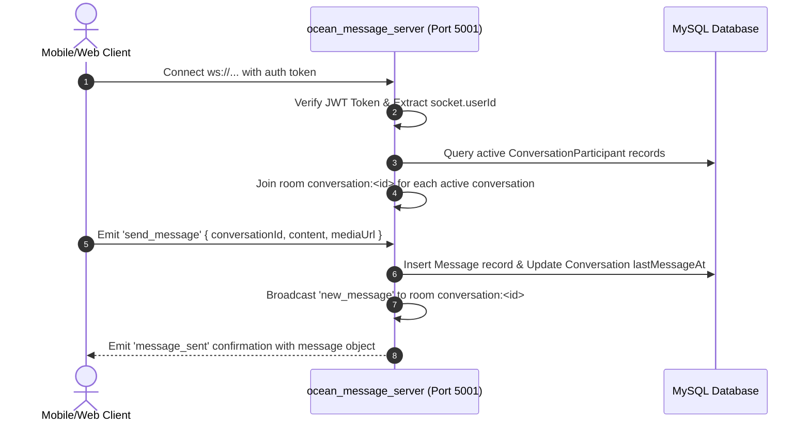

# 💬 Real-Time Chatting & Messaging Engine Architecture

This document details the **Standalone `ocean_message_server` Microservice, Socket.io Real-Time Protocol, Conversation Threads, and Message Delivery Receipts** in `ocean_app`.

---

## 📌 Architectural Overview & Philosophy

Real-time messaging is handled by a dedicated microservice: `ocean_message_server` running on Port 5001:
1. **Standalone Microservice Architecture**: Decoupled from `ocean_server` to ensure chat websockets do not compete for event-loop CPU with API endpoints.
2. **Socket.io Handshake & JWT Verification**: Clients connect via Socket.io (`ws://...`). The socket connection validates the user's JWT token, authenticates `socket.userId`, and auto-joins all active conversation rooms (`conversation:<id>`).
3. **Real-Time Events**:
   - `send_message`: Dispatches instant text or media messages to conversation rooms.
   - `typing_start` / `typing_stop`: Broadcasts real-time typing indicators.
   - `message_read`: Emits read receipts and updates `lastReadAt`.
4. **Rich Content & Context Linkage**: Supports text, image/video URLs, voice notes, nested reply threads (`replyToId`), and entity links (`relatedType`: `'product'`, `'buyer_need'`, `'auction'`, `'swap_deal'`, `'group_buy'`).

---

## 🗄️ Database Schemas (`conversations`, `messages`, `conversation_participants`)

### 1. `conversations` Table
- `id` (`UUID`, Primary Key, `UUIDV4`)
- `title` (`VARCHAR(255)`, `NULLABLE`)
- `type` (`ENUM`: `'direct'`, `'group'`, `'buyer_need'`, `'group_buy'`)
- `lastMessageAt` (`DATETIME`, `NULLABLE`)
- `lastMessageId` (`UUID`, `NULLABLE`)
- `relatedType` (`VARCHAR(50)`, `NULLABLE`, Comment: 'product, buyer_need, group_buy')
- `relatedId` (`VARCHAR(255)`, `NULLABLE`, Comment: 'ID of related entity')
- `createdAt` (`DATETIME`)
- `updatedAt` (`DATETIME`)

### 2. `messages` Table
- `id` (`UUID`, Primary Key, `UUIDV4`)
- `conversationId` (`UUID`, Foreign Key -> `conversations.id`)
- `senderId` (`UUID`, Foreign Key -> `users.id`)
- `content` (`TEXT`, `NULLABLE`)
- `type` (`ENUM`: `'text'`, `'image'`, `'video'`, `'audio'`, `'document'`, `'system'`)
- `replyToId` (`UUID`, `NULLABLE`, Foreign Key -> `messages.id`)
- `mediaUrl` (`VARCHAR(500)`, `NULLABLE`)
- `mediaType` (`VARCHAR(50)`, `NULLABLE`)
- `status` (`ENUM`: `'sent'`, `'delivered'`, `'read'`)
- `createdAt` (`DATETIME`)

---

## ⚙️ Real-Time Socket.io Connection Sequence

---

## 🔌 API Endpoints Reference (`ocean_message_server`)

### Conversation Routes

| Endpoint Path | Method | Description |
| :--- | :--- | :--- |
| `/api/conversations` | `GET` | Fetch authenticated user's active conversations |
| `/api/conversations/direct` | `POST` | Create or fetch existing 1-on-1 direct conversation |
| `/api/conversations/:id` | `GET` | Get single conversation details with participants |

### Message Routes

| Endpoint Path | Method | Description |
| :--- | :--- | :--- |
| `/api/messages/:conversationId` | `GET` | Fetch paginated chat history for a conversation |
| `/api/messages/:conversationId/read` | `POST` | Mark messages in conversation as read |
| `/api/messages/:messageId` | `DELETE` | Delete a message for authenticated user |

---

## 🛠️ Audit Summary & Status

1. **Microservice Decoupling Verified**: Confirmed socketHandler running on Port 5001 with JWT token verification.
2. **Context Linkage Supported**: Links direct chats directly to products, buyer demands, group buys, and swap deals.
