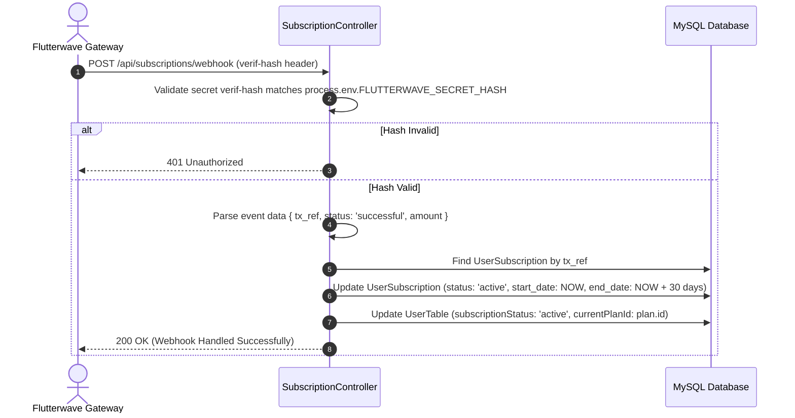

# 💳 Subscriptions & Payment Webhooks Architecture

This document details the **Subscription Engine, Tier Plan Limits, Flutterwave Payment Webhook Verification, and Auto-Expiration Pipeline** in `ocean_server`.

---

## 📌 Architectural Overview & Philosophy

The Subscription System governs seller monetization, access permissions, and feature allowances:
1. **5 Tier Subscription Plans**:
   - **Drift** (Free Tier): Basic listing capabilities, zero direct notifications.
   - **Wave** (Standard Tier): Increased listing limit, basic feature access.
   - **Tide** (Professional Tier): 7 daily buyer demand lead notifications, 3D AR uploads, priority ranking.
   - **Surge** (Enterprise Tier): 15 daily buyer demand lead notifications, unlimited AR uploads, highest search priority, free monthly promotional boosts.
   - **Custom**: Tailored enterprise quotas.
2. **Flutterwave Payment Webhook**: Receives real-time payment events (`POST /api/subscriptions/webhook`), validates Flutterwave secret signatures, activates subscriptions, and provisions feature quotas.
3. **Automated Expiry Scheduler**: Daily cron job checks expired user subscriptions (`end_date <= NOW`), updates `subscription_status = 'expired'`, and downgrades users back to the `Drift` free tier.

---

## 🗄️ Database Schemas (`subscription_plans` & `user_subscriptions`)

### 1. `subscription_plans` Table
- `id` (`INTEGER`, Primary Key, Auto Increment)
- `name` (`VARCHAR(50)`, `UNIQUE`: `'drift'`, `'wave'`, `'tide'`, `'surge'`)
- `display_name` (`VARCHAR(100)`, `NOT NULL`)
- `price` (`DECIMAL(10,2)`, `NOT NULL`)
- `price_usd` (`DECIMAL(10,2)`, `NULLABLE`)
- `billing_period` (`ENUM`: `'monthly'`, `'yearly'`, Default `'monthly'`)
- `max_listings` (`INTEGER`, Default `0`)
- `max_group_buys` (`INTEGER`, Default `0`)
- `max_swap_deals` (`INTEGER`, Default `0`)
- `max_auctions` (`INTEGER`, Default `0`)
- `max_distress_sales` (`INTEGER`, Default `0`)
- `max_daily_dms` (`INTEGER`, Default `0`)
- `max_daily_notifications` (`INTEGER`, Default `0`)
- `max_ar_products` (`INTEGER`, Default `0`)
- `max_promotional_boosts` (`INTEGER`, Default `0`)
- `can_create_group_buy` (`BOOLEAN`, Default `false`)
- `can_create_swap_deals` (`BOOLEAN`, Default `false`)
- `can_create_auctions` (`BOOLEAN`, Default `false`)
- `can_create_distress_sales` (`BOOLEAN`, Default `false`)
- `can_use_ar` (`BOOLEAN`, Default `false`)
- `has_verified_badge` (`BOOLEAN`, Default `false`)
- `has_priority_search` (`BOOLEAN`, Default `false`)
- `has_buyer_insights` (`BOOLEAN`, Default `false`)
- `is_active` (`BOOLEAN`, Default `true`)

### 2. `user_subscriptions` Table
- `id` (`INTEGER`, Primary Key, Auto Increment)
- `user_id` (`UUID`, Foreign Key -> `users.id`)
- `plan_id` (`INTEGER`, Foreign Key -> `subscription_plans.id`)
- `status` (`ENUM`: `'active'`, `'expired'`, `'cancelled'`, `'pending'`)
- `start_date` (`DATETIME`, `NOT NULL`)
- `end_date` (`DATETIME`, `NOT NULL`)
- `auto_renew` (`BOOLEAN`, Default `true`)
- `flutterwave_tx_ref` (`VARCHAR(255)`, `NULLABLE`)

---

## ⚙️ Flutterwave Payment Webhook Sequence

---

## 🔌 API Endpoints Reference

### Public Routes

| Endpoint Path | Method | Description |
| :--- | :--- | :--- |
| `/api/subscriptions/plans` | `GET` | List available subscription plans & pricing |
| `/api/subscriptions/webhook` | `POST` | Flutterwave payment event webhook endpoint |

### Authenticated Seller Routes

| Endpoint Path | Method | Description |
| :--- | :--- | :--- |
| `/api/subscriptions/current` | `GET` | Get authenticated seller's active plan & remaining limits |
| `/api/subscriptions/subscribe` | `POST` | Initiate plan subscription & receive Flutterwave payment URL |
| `/api/subscriptions/cancel` | `POST` | Cancel auto-renewal for current subscription |

---

## 🛠️ Audit Summary & Status

1. **Webhook Security Verified**: Confirms Flutterwave secret hash verification before updating user subscription records.
2. **Tier Limit Enforcement**: Integrated with `checkSubscriptionLimit` middleware across listing endpoints.
