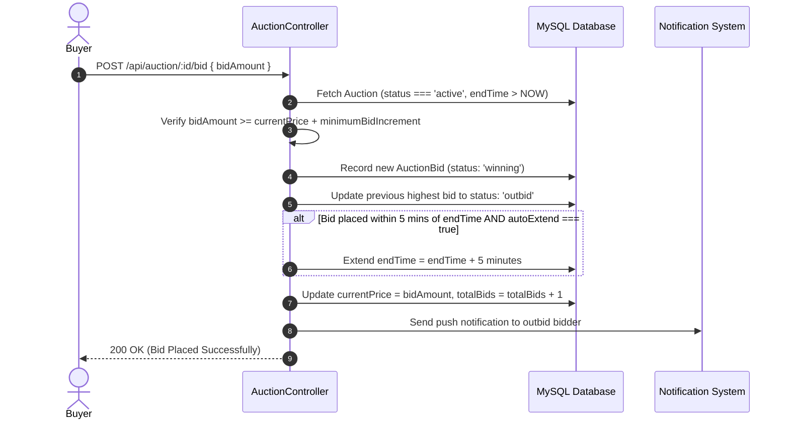

# 🔨 Auction & Bidding System Architecture

This document provides a comprehensive technical reference for the **Auction Engine, Live Bidding Pipeline, Buy Now Requests, Sniping Protection, and Expiration Loop** in `ocean_server`.

---

## 📌 Architectural Overview & Philosophy

The Auction System empowers sellers to host live competitive bidding events for unique or high-demand goods. Key system features include:
1. **Live Bidding Pipeline**: Buyers submit bids via `POST /api/auction/:auctionId/bid`. Bids must exceed `currentPrice + minimumBidIncrement`.
2. **Sniping Protection (5-Minute Auto-Extend)**: If a bid is submitted within the last 5 minutes before `endTime`, the auction `endTime` automatically extends by 5 minutes (`autoExtendMinutes`). This prevents automated last-second bid sniping.
3. **Reserve Price Mechanics**: If `reservePrice` is set, `isReserveMet` remains `false` until a bid reaches or exceeds `reservePrice`.
4. **Instant Buy Now Option**: If `buyNowEnabled` is `true`, buyers can bypass bidding and purchase the item instantly at `buyNowPrice` or submit a Buy Now request.
5. **Background Expiration Cron**: Background scheduler checks active auctions (`endTime <= NOW`). If `reservePrice` is met, the highest bidder is assigned as `winnerId` and notification is sent.

---

## 🗄️ Database Schema (`auctions` & Related Tables)

### 1. `auctions` Table
- `id` (`UUID`, Primary Key)
- `sellerId` (`UUID`, Foreign Key -> `sellers.id`)
- `title` (`VARCHAR(255)`, `NOT NULL`)
- `description` (`TEXT`, `NOT NULL`)
- `startingPrice` (`DECIMAL(15,2)`, `NOT NULL`)
- `currentPrice` (`DECIMAL(15,2)`, Default `0.00`)
- `reservePrice` (`DECIMAL(15,2)`, `NULLABLE`)
- `minimumBidIncrement` (`DECIMAL(15,2)`, Default `1.00`)
- `startTime` (`DATETIME`, `NOT NULL`)
- `endTime` (`DATETIME`, `NOT NULL`)
- `status` (`ENUM`: `'draft'`, `'active'`, `'paused'`, `'ended'`, `'cancelled'`, `'sold'`)
- `totalBids` (`INTEGER`, Default `0`)
- `uniqueBidders` (`INTEGER`, Default `0`)
- `isReserveMet` (`BOOLEAN`, Default `false`)
- `winnerId` (`UUID`, Foreign Key -> `users.id`, `NULLABLE`)
- `winningBidAmount` (`DECIMAL(15,2)`, `NULLABLE`)
- `autoExtend` (`BOOLEAN`, Default `false`)
- `autoExtendMinutes` (`INTEGER`, Default `5`)
- `buyNowPrice` (`DECIMAL(15,2)`, `NULLABLE`)
- `buyNowEnabled` (`BOOLEAN`, Default `true`)
- `boughtAt` (`DATETIME`, `NULLABLE`)
- `buyerId` (`UUID`, Foreign Key -> `users.id`, `NULLABLE`)
- `is_boosted` (`BOOLEAN`, Default `false`)
- `is_top_placed` (`BOOLEAN`, Default `false`)
- `is_spotlighted` (`BOOLEAN`, Default `false`)
- `visibility_score` (`DECIMAL(10,2)`, Default `0.00`)

### 2. `auction_bids` Table
- `id` (`UUID`, Primary Key)
- `auctionId` (`UUID`, Foreign Key -> `auctions.id`)
- `bidderId` (`UUID`, Foreign Key -> `users.id`)
- `bidAmount` (`DECIMAL(15,2)`, `NOT NULL`)
- `status` (`ENUM`: `'active'`, `'outbid'`, `'winning'`, `'cancelled'`)
- `createdAt` (`DATETIME`)

---

## ⚙️ Bidding Logic & Auto-Extend Sequence

---

## 🔌 API Endpoints Reference

### Public Routes

| Endpoint Path | Method | Description |
| :--- | :--- | :--- |
| `/api/auctions` | `GET` | List active auctions (Redis cached 180s) |
| `/api/auctions/trending` | `GET` | Trending auctions sorted by total bids & score |
| `/api/auction/:auctionId` | `GET` | Single auction details with current bid history |
| `/api/auction/:auctionId/bids` | `GET` | List all bids placed on an auction |

### Authenticated Buyer / Seller Routes

| Endpoint Path | Method | Description |
| :--- | :--- | :--- |
| `/api/auctions` | `POST` | Create a new live auction |
| `/api/auction/:auctionId/bid` | `POST` | Submit a competitive bid |
| `/api/auction/:auctionId/buy-now` | `POST` | Instantly purchase item at Buy Now price |
| `/api/auction/:auctionId/watch` | `POST` | Add/remove auction from watch list |
| `/api/auction/:auctionId` | `DELETE` | Cancel auction (Seller only) |
| `/api/auction/:auctionId/select-winner` | `POST` | Manually select winning bid (Seller only) |

---

## 🛠️ Audit Summary & Status

1. **Auto-Extend Sniping Protection Verified**: Confirmed 5-minute auto-extend calculation logic in `auctionController.placeBid`.
2. **Standardized Response Mapping**: Mapped `savedCount` and promotional tags cleanly.
