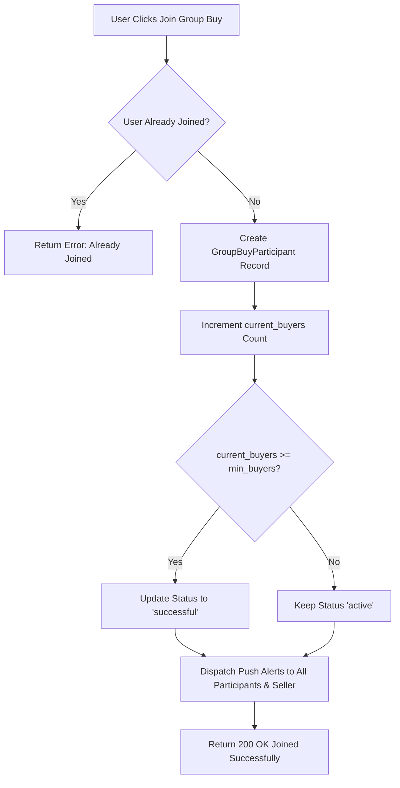

# 👥 Group Buy (Bulk Purchase) System Architecture

This document provides a comprehensive technical reference for the **Group Buy System, Buyer Threshold Engine, Automatic Discount Activation, and Chat Room Integration** in `ocean_server`.

---

## 📌 Architectural Overview & Philosophy

The Group Buy System enables buyers to pool purchasing power to unlock wholesale discount pricing (`group_price`) on products:
1. **Commitment Threshold**: Sellers or buyers set a minimum buyer threshold (`min_buyers`, e.g. 5 buyers). The discount is locked in when `current_buyers >= min_buyers`.
2. **Automatic Lifecycle Transition**:
   - `status = 'pending'`: Group buy created, waiting for first buyer.
   - `status = 'active'`: Group buy open for buyers to join.
   - `status = 'successful'`: Target `min_buyers` reached before `deadline`.
   - `status = 'failed'`: Deadline passed without reaching `min_buyers`.
3. **Integrated Group Chat Linkage**: When a group buy is created, a dedicated real-time chat room (`conversation_id`) is linked so joined buyers can interact.
4. **Deadline Extension**: Sellers can extend the deadline (`deadline_extended_at`) if a group buy is close to reaching its buyer threshold.

---

## 🗄️ Database Schema (`group_buys` & `group_buy_participants`)

### 1. `group_buys` Table
- `id` (`INTEGER`, Primary Key, Auto Increment)
- `title` (`VARCHAR(255)`, `NOT NULL`)
- `description` (`TEXT`, `NOT NULL`)
- `category` (`VARCHAR(255)`, `NOT NULL`)
- `product_name` (`VARCHAR(255)`, `NOT NULL`)
- `product_image` (`JSON`, `NULLABLE`)
- `ar_model` (`VARCHAR(500)`, `NULLABLE`)
- `original_price` (`DECIMAL(10,2)`, `NOT NULL`)
- `group_price` (`DECIMAL(10,2)`, `NOT NULL`)
- `min_buyers` (`INTEGER`, Default `2`)
- `max_buyers` (`INTEGER`, `NULLABLE`)
- `quantity_unit` (`INTEGER`, `NULLABLE`)
- `remaining_units` (`INTEGER`, `NULLABLE`)
- `current_buyers` (`INTEGER`, Default `0`)
- `status` (`ENUM`: `'pending'`, `'active'`, `'successful'`, `'failed'`, `'cancelled'`)
- `creator_id` (`UUID`, Foreign Key -> `users.id`)
- `seller_id` (`UUID`, Foreign Key -> `sellers.id`, `NULLABLE`)
- `conversation_id` (`VARCHAR(36)`, `NULLABLE`, Foreign Key -> `conversations.id`)
- `deadline` (`DATETIME`, `NOT NULL`)
- `savedCount` (`INTEGER`, Default `0`)
- `is_boosted` (`BOOLEAN`, Default `false`)
- `visibility_score` (`DECIMAL(10,2)`, Default `0.00`)

### 2. `group_buy_participants` Table
- `id` (`INTEGER`, Primary Key, Auto Increment)
- `group_buy_id` (`INTEGER`, Foreign Key -> `group_buys.id`)
- `user_id` (`UUID`, Foreign Key -> `users.id`)
- `quantity` (`INTEGER`, Default `1`)
- `payment_status` (`ENUM`: `'pending'`, `'escrow_locked'`, `'refunded'`, `'completed'`)
- `joined_at` (`DATETIME`)

---

## ⚙️ Joining Workflow & Status Transition

---

## 🔌 API Endpoints Reference

### Public Routes

| Endpoint Path | Method | Description |
| :--- | :--- | :--- |
| `/api/group-buys` | `GET` | List active group buys (Redis cached 180s) |
| `/api/group-buys/trending` | `GET` | Fetch top trending group buys |
| `/api/group-buys/:id` | `GET` | Get single group buy details & participants list |

### Authenticated Routes

| Endpoint Path | Method | Description |
| :--- | :--- | :--- |
| `/api/group-buys` | `POST` | Create a new group buy offer |
| `/api/group-buys/:id/join` | `POST` | Join an active group buy |
| `/api/group-buys/:id/leave` | `POST` | Leave a group buy before deadline |
| `/api/group-buys/:id/extend` | `POST` | Extend deal deadline (Creator / Seller only) |
| `/api/group-buys/:id/cancel` | `DELETE` | Cancel group buy |

---

## 🛠️ Audit Summary & Status

1. **Standardized Response Mappings**: Aligned `savedCount` and participant counts.
2. **Escrow Integration**: Group buy commitments lock buyer payment in escrow until `min_buyers` threshold is reached.
