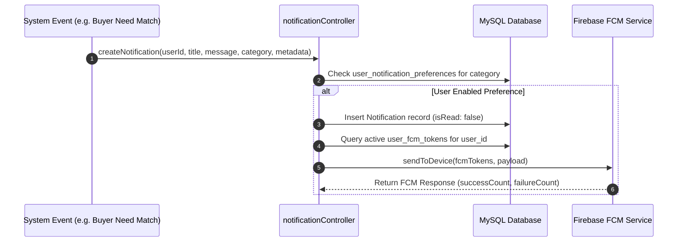

# 🔔 Notifications & FCM Push System Architecture

This document details the **Notification Pipeline, In-App Alert Logging, Firebase FCM Device Token Registration, and User Preference Management** in `ocean_server`.

---

## 📌 Architectural Overview & Philosophy

The Notification Engine delivers real-time system alerts and push notifications to buyers and sellers:
1. **Multi-Channel Dispatching**: Supports `in_app` notification logs, `push` notifications (FCM), and `email` alerts.
2. **Firebase Admin SDK (FCM)**: Registers device push tokens (`user_fcm_tokens`) for iOS, Android, and Web clients. Dispatches FCM data push notifications asynchronously.
3. **Seeded User Notification Preferences**: Every new user receives default preference records (`UserNotificationPreference`) for 13 system alert categories (`buyer_need_match`, `price_drop`, `auction_ending`, `new_follower`, etc.). Users can customize channel delivery per category.
4. **Notification Priority Tiers**: Supports priority levels (`low`, `medium`, `high`, `urgent`).

---

## 🗄️ Database Schemas (`notifications`, `user_fcm_tokens`, `user_notification_preferences`)

### 1. `notifications` Table
- `id` (`UUID`, Primary Key, `UUIDV4`)
- `userId` (`UUID`, Foreign Key -> `users.id`)
- `title` (`VARCHAR(255)`, `NOT NULL`)
- `message` (`TEXT`, `NOT NULL`)
- `type` (`ENUM`: `'info'`, `'success'`, `'warning'`, `'error'`, `'admin'`)
- `category` (`VARCHAR(50)`, `NOT NULL`, Default `'system'`)
- `isRead` (`BOOLEAN`, Default `false`)
- `readAt` (`DATETIME`, `NULLABLE`)
- `metadata` (`JSON`, `NULLABLE`)
- `priority` (`ENUM`: `'low'`, `'medium'`, `'high'`, `'urgent'`)

### 2. `user_fcm_tokens` Table
- `id` (`UUID`, Primary Key)
- `user_id` (`UUID`, Foreign Key -> `users.id`)
- `fcm_token` (`TEXT`, `NOT NULL`)
- `device_type` (`ENUM`: `'android'`, `'ios'`, `'web'`)
- `is_active` (`BOOLEAN`, Default `true`)
- `last_used_at` (`DATETIME`)

### 3. `user_notification_preferences` Table
- `id` (`INTEGER`, Primary Key, Auto Increment)
- `user_id` (`UUID`, Foreign Key -> `users.id`)
- `notification_type` (`VARCHAR(100)`, `NOT NULL`)
- `is_enabled` (`BOOLEAN`, Default `true`)
- `delivery_methods` (`JSON`, Default `["in_app", "email", "push"]`)
- `priority_threshold` (`ENUM`: `'low'`, `'medium'`, `'high'`, `'urgent'`)

---

## ⚙️ FCM Push Notification Dispatch Sequence

---

## 🔌 API Endpoints Reference

### Notification Management Routes

| Endpoint Path | Method | Description |
| :--- | :--- | :--- |
| `/api/notifications` | `GET` | Fetch authenticated user's notification log (with `unreadCount`) |
| `/api/notifications/:id/read` | `POST` | Mark single notification as read |
| `/api/notifications/read-all` | `POST` | Mark all user notifications as read |
| `/api/fcm-token` | `POST` | Register/update device FCM push token |
| `/api/fcm-token` | `DELETE` | Unregister FCM push token on logout |
| `/api/notifications/preferences` | `GET` | Fetch user's notification preferences |
| `/api/notifications/preferences` | `PUT` | Update category notification preferences |

---

## 🛠️ Audit Summary & Status

1. **Preference Seeding Optimized**: Confirmed `UserTable.afterCreate` hook uses `bulkCreate` to seed default preferences in a single DB query.
2. **FCM Error Handling**: Invalid or expired FCM device tokens are automatically marked inactive on push failure.
